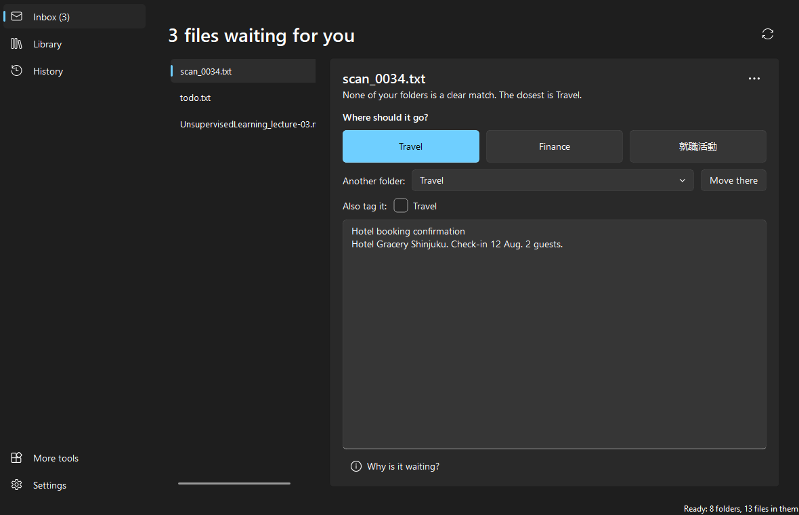
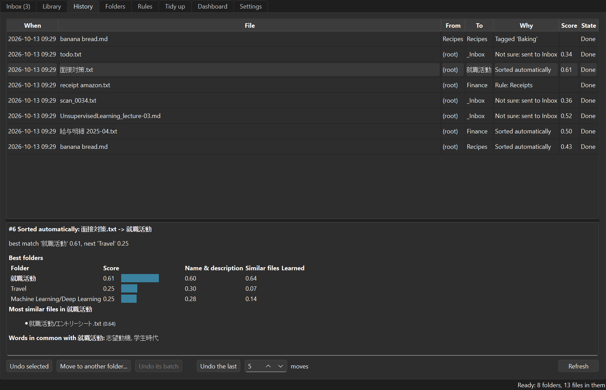
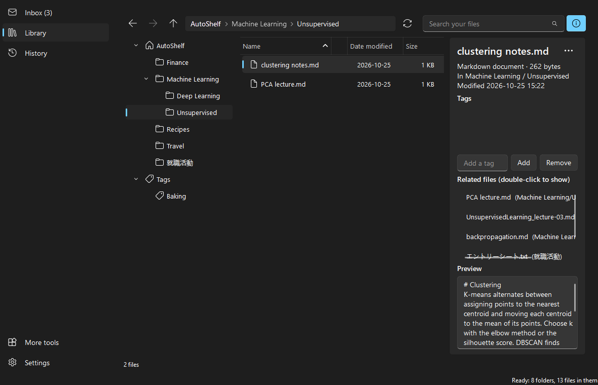
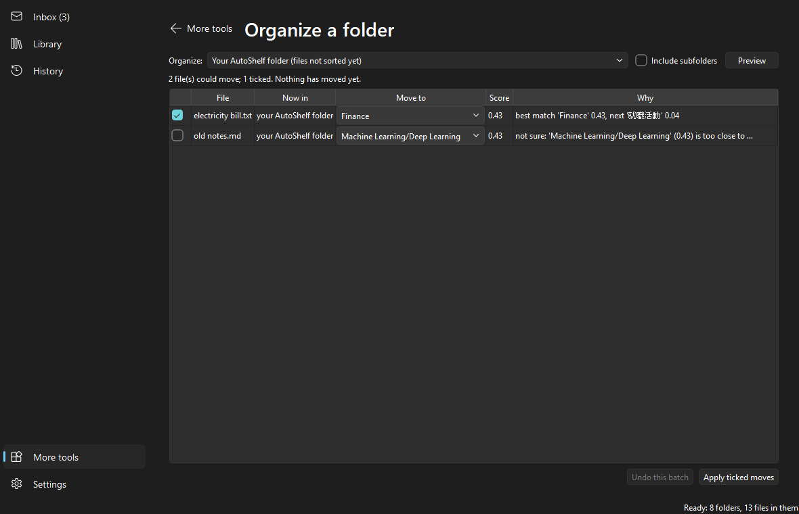
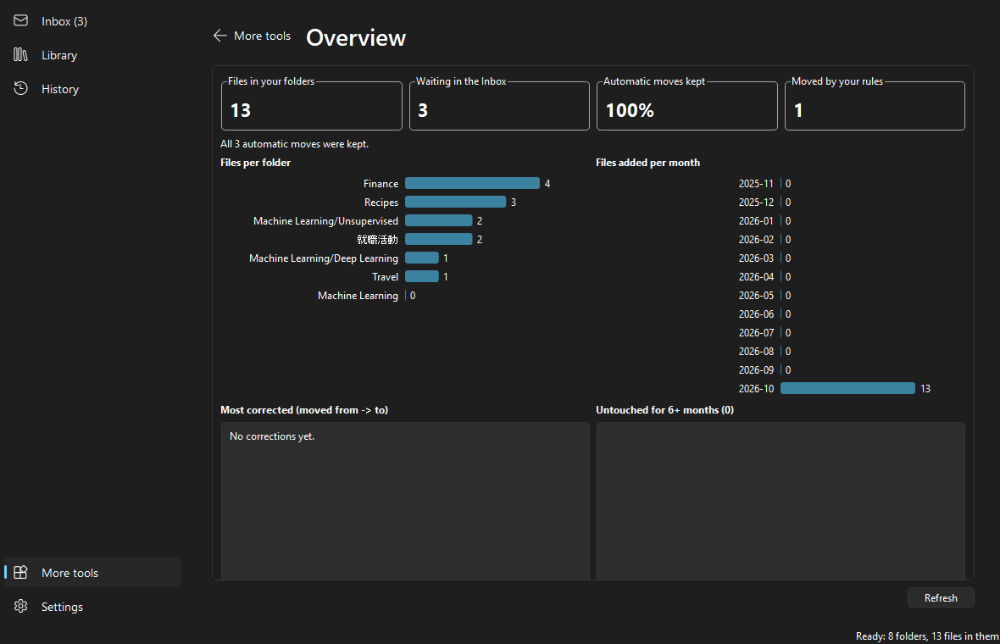
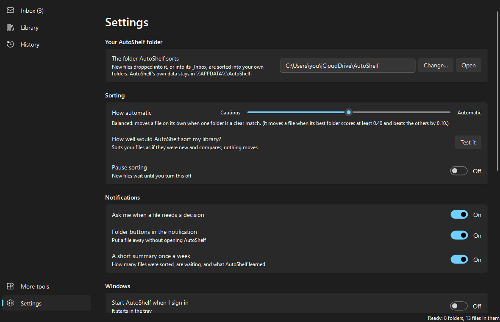

# AutoShelf

[](https://github.com/HarukiU06/Folder-sorting-system/actions/workflows/tests.yml)

A personal Windows desktop app that watches one root folder (for example inside iCloud Drive),
reads each new file's **name and text**, and moves it into the right folder **that you created**.
When it isn't confident, it asks. It learns from your corrections. The full design is in
[SPEC.md](SPEC.md).

> **Status:** phases 0–15 of [SPEC.md](SPEC.md) are built: a Windows tray app (and a
> command-line tool) that reads each new file and either moves it into the right folder, when
> it is sure, or into `_Inbox/` for you to decide, with full history and undo. It learns from
> your corrections, follows your rules, explains every decision, helps you search and tidy
> your library, and makes smaller copies or copies in other formats. It adds itself to
> Explorer's right-click menu, answers from notification buttons, comes with an installer,
> sums up your week, and says how long getting ready will take before it starts. Optional AI
> features (off by default) add summaries, better names, answers from your files and study
> tools.

| Inbox | History | Library |
|---|---|---|
|  |  |  |
| **Organize a folder** (More tools) | **Overview** (More tools) | **Settings** |
|  |  |  |

## Safety rules

AutoShelf moves real files, so:

- it **never deletes** a file and **never overwrites** one: name clashes get ` (2)`, ` (3)`, …;
- it only works inside the root you choose, and refuses paths that lead outside it;
- it records every move in its history **before** doing it, so every move can be undone;
- it never creates category folders (only its own `_Inbox/`, `_Duplicates/` and `_Trash/`,
  when first needed);
- compressing or converting a file always makes a **new** file next to it; the original
  stays as it is, and undoing sets the new file aside in `_Trash/`;
- it only moves a file on its own when one folder is a clear match; otherwise it asks;
- it waits until a file has stopped changing for 3 seconds and no program is still writing it;
- it ignores temporary and partial files (`~$*`, `*.tmp`, `*.crdownload`, `*.part`,
  `*.download`, `desktop.ini`, `.DS_Store`, `Thumbs.db`) and hidden or system files;
- its database and logs live in `%APPDATA%\AutoShelf\`, never inside the synced folder.

## Folder layout

```
AutoShelf/                  <- the root you pass with --root
├── _Inbox/                 <- files waiting for your decision
├── _Duplicates/            <- copies you chose to set aside (delete them yourself)
├── _Trash/                 <- copies AutoShelf made and you undid (delete them yourself)
├── Finance/                <- your own folders; files you put here are never moved
├── Machine Learning/
│   └── Unsupervised/
└── new file.pdf            <- files dropped here (or into _Inbox) get processed
```

Folders whose names start with `_` are reserved and are never treated as categories.

## Setup (Windows)

Requires Python 3.12 or newer. If `python --version` shows an older version, use the `py`
launcher as below.

```powershell
py -3.13 -m venv .venv
.venv\Scripts\python.exe -m pip install -e ".[dev]"
```

This installs PyTorch (the CPU build, about 1 GB in the venv). The first command that sorts
or classifies files also downloads the language model (about 470 MB) into
`%APPDATA%\AutoShelf\cache\models`; after that everything runs offline, on your PC.

The commands below call the venv's Python directly, so they work without activating it.
(If you do run `.venv\Scripts\Activate.ps1` and PowerShell blocks it, run
`Set-ExecutionPolicy -Scope CurrentUser RemoteSigned` once; after activating, plain `python`
works.)

## The desktop app

```powershell
.venv\Scripts\autoshelf-app.exe          # or: .venv\Scripts\python.exe -m autoshelf
```

On first start it asks for the folder to sort. It suggests `iCloud Drive\AutoShelf` (and
makes it if you like), warns if you pick the top of iCloud Drive itself (every folder in it,
Desktop and Documents too, would become a place to sort into), and says how long getting
ready will take before you start: "12 files in your folders, 1 new file to sort now, a
one-time download of the language model (470 MB). About 1 to 4 minutes." The estimate looks
at names and sizes only, so nothing is read or downloaded from iCloud for it. Then **Start
sorting**, or **Start paused** to look first. While AutoShelf gets ready, a bar above every
page shows what it is doing and the time left ("Reading your folders: 1,200 of 4,244 files,
about 1 minute left").

AutoShelf then lives in the system tray. Its window has a sidebar:

- **Inbox:** files it wasn't sure about, with its best three folders as big buttons (the
  first is its best guess), any other folder, a text preview and, in a sentence, why the
  file is waiting. One click puts the file away (and teaches AutoShelf for next time); the
  message that follows offers Undo. Rename, open and show in Explorer are in the ⋯ menu;
  "Why is it waiting?" shows the scores and what they are based on.
- **Library:** your folders the way File Explorer shows them: a folder tree on the left
  (your tags below it), Back / Forward / Up and the folder's path above, and the open
  folder's folders and files with their dates and sizes (a cloud marks files that are
  only in iCloud). Double-click a folder to go into it, a file to open it; right-click
  either for more. The pane on the right shows the selected file (details, tags, related
  files, a preview; its ⋯ menu renames, compresses or converts it) or folder (a short
  description you can edit, which helps AutoShelf recognise what belongs there). Search
  by meaning or by exact words from the box at the top right: matching folders come
  first, then files. The Library only browses: it never moves, deletes or makes folders.
- **History:** what AutoShelf did, in sentences ("Moved bread.txt to Recipes", how and
  when). Undo the selected row, or move a file AutoShelf put in the wrong folder to the
  right one ("Move to another folder", which AutoShelf learns from); "Why?" shows the
  explanation. Undoing a whole batch or the last few moves is in the ⋯ menu.
- **Ask** (only with AI on): questions about your files, answered with citations.
- **More tools:** organize a messy folder (preview, then one undoable batch), duplicates,
  possible versions, better names, new folders, and an overview: files per folder, files
  added per month, how many automatic moves you kept, the most corrected folders, and files
  untouched for six months (not changed, added or opened from AutoShelf: Windows doesn't
  reliably record when you open a file elsewhere).
- **Settings:** your AutoShelf folder; sorting (a Cautious ↔ Automatic slider, "How well
  would AutoShelf sort my library?", pause); notifications (their buttons, the weekly
  summary); Windows (start when you sign in, the Explorer menu); your rules (see below);
  and files sorted by name only (to read them again). "Show advanced settings" has which
  files to ignore, how long to wait for a file, how often to look for missed files, other
  folders to watch (optional, e.g. Downloads), whether compressed and converted copies are
  sorted, and the optional AI.

The window follows Windows' light or dark mode.

When a file needs your decision, a notification asks "Where should *file* go?" with the best
guesses; click it to open the Inbox with that file selected. When AutoShelf is installed
with the installer (or Settings → "Folder buttons in the notification" is on), the
notification also
has a button for each of the best three folders and "Leave in Inbox": a folder button puts
the file there (AutoShelf learns from it, as from the Inbox, and History can undo it), even
if AutoShelf was closed in the meantime. The buttons open `autoshelf:` links, which carry
only a random code that works once and expires after 14 days, never a file name, so a link
on a web page can't make AutoShelf move anything.

Once a week a notification sums up what AutoShelf did: "This week: 23 sorted, 3 waiting
in Inbox, 1 correction learned" (files put into your folders and not undone, files in the
Inbox now, and Inbox answers and corrections it learned from); clicking it opens the
overview (More tools). As AutoShelf isn't always running, it looks when it starts and then every hour;
the first start only starts counting, and a week with nothing to tell is skipped. Settings
turns it off; `autoshelf digest` prints the same line any time.

The tray menu can pause sorting: new files then wait until you resume. Closing the window
keeps AutoShelf running; quit it from the tray menu. Only one AutoShelf
sorts at a time: starting the app again just shows its window, and `autoshelf watch`
refuses to run while the app does.

### Start with Windows

Settings → Windows → "Start AutoShelf when I sign in" (or `autoshelf config --startup on`)
adds an entry to your user's startup programs (the registry's `Run` key; no administrator
rights). AutoShelf then starts in the tray without opening its window. Turn it off the same
way. `autoshelf --background` starts it like that by hand.

### Explorer's right-click menu

Settings → Windows → "AutoShelf in Explorer's right-click menu" (or
`autoshelf config --explorer-menu on`) adds, for your Windows user only (no administrator
rights):

- **AutoShelf ▸ Sort with AutoShelf:** a preview (More tools → Organize a folder) of where the selected
  files would go. Nothing moves until you click Apply, and the moves form one batch you can
  undo. Files outside your library can come from a folder on the same drive; a file on
  another drive gets a message instead, because AutoShelf only moves files (it never copies
  and deletes them).
- **AutoShelf ▸ Why is this here?** what AutoShelf did with the file and why, or that it has
  no record of moving it.
- **AutoShelf ▸ Compress** and **Convert with AutoShelf ▸** (only on file types it can
  convert, with the formats available on your PC): see [Compress and convert](#compress-and-convert).

On Windows 11 the entries are under "Show more options". Several selected files are handled
together (one ZIP, one PDF of several images, one preview). If AutoShelf isn't running, the
menu starts it. The same commands work from a terminal: `AutoShelf.exe --sort FILE ...`,
`--why FILE`, `--compress FILE ...`, `--convert pdf FILE ...` (from source:
`.venv\Scripts\python.exe -m autoshelf --sort FILE ...`).

## Building the app (no Python needed to run it)

```powershell
.venv\Scripts\python.exe -m pip install -e ".[build]"
powershell -ExecutionPolicy Bypass -File packaging\build.ps1
```

This makes `dist\AutoShelf\` (about 850 MB, mostly PyTorch) with `AutoShelf.exe`, the tray app,
and `autoshelf-cli.exe`, the command line. Copy the whole folder anywhere and run
`AutoShelf.exe`; the language model is downloaded on first start, as when running from
source. The build uses a hand-written PyInstaller spec (`packaging\autoshelf.spec`) and
builds one folder rather than one file, so it starts quickly and its libraries stay
replaceable.

### The installer

```powershell
winget install JRSoftware.InnoSetup                                # once: Inno Setup 6
powershell -ExecutionPolicy Bypass -File packaging\installer.ps1   # after build.ps1
```

This makes `dist\AutoShelf-<version>-setup.exe` (`packaging\autoshelf.iss`). It installs for
your Windows user only, without administrator rights, into
`%LOCALAPPDATA%\Programs\AutoShelf`, with a Start-menu shortcut. It registers AutoShelf with
Windows for notification buttons and, if you leave the options ticked, adds the Explorer menu
and starts AutoShelf when you sign in. Uninstalling (Settings → Apps) quits AutoShelf and
removes all of that again, including the menu entries, the sign-in entry and the
`autoshelf:` link, but keeps `%APPDATA%\AutoShelf` (your history and settings, so earlier
moves stay undoable if you reinstall). Your files are never touched. The installer isn't
code-signed, so Windows SmartScreen may warn before it runs ("More info" → "Run anyway").

### Releases

Pushing a tag that matches the version in `autoshelf\__init__.py` (for example `v0.1.0`)
runs `.github\workflows\release.yml`: it builds the app and the installer on GitHub's
Windows runner and attaches `AutoShelf-<version>-setup.exe` and a ZIP of the app folder to
a GitHub Release.

## Command line

Sorting, the Inbox, folder descriptions, history and undo also work from the command line.
Try it on a throwaway folder first, never on your real files:

```powershell
New-Item -ItemType Directory -Force "C:\workspace\AutoShelf-sandbox\Finance"
New-Item -ItemType Directory -Force "C:\workspace\AutoShelf-sandbox\Recipes"

# Remember the root, so the other commands don't need --root
.venv\Scripts\python.exe -m autoshelf config --root "C:\workspace\AutoShelf-sandbox"

# Optional but helpful, especially for folders that are still empty
.venv\Scripts\python.exe -m autoshelf describe Finance "invoices, receipts, bank statements, taxes"
.venv\Scripts\python.exe -m autoshelf describe Recipes "cooking recipes and baking"
.venv\Scripts\python.exe -m autoshelf folders

# Dry run: watch and report what would happen, without moving anything
.venv\Scripts\python.exe -m autoshelf watch --dry-run

# Real run: new files are sorted into your folders, or into _Inbox\ (Ctrl+C to stop)
.venv\Scripts\python.exe -m autoshelf watch
```

While it runs, drop files into the root (or into `_Inbox\`, e.g. from your iPhone). Then:

```powershell
# Which folder would this file go to, and why? (reads the file, moves nothing)
.venv\Scripts\python.exe -m autoshelf classify "C:\path\to\any file.pdf"

# Files waiting for you, with suggestions; answer one
.venv\Scripts\python.exe -m autoshelf inbox
.venv\Scripts\python.exe -m autoshelf assign "scan_0034.pdf" "Finance"

# See what happened, and undo it
.venv\Scripts\python.exe -m autoshelf history
.venv\Scripts\python.exe -m autoshelf undo 3          # undo history entry #3
.venv\Scripts\python.exe -m autoshelf undo --last 5   # undo the 5 most recent moves
```

Rules, learning and explanations:

```powershell
# Rules are checked first, in order; the first match decides
.venv\Scripts\python.exe -m autoshelf rules add Invoices --name-matches "invoice|receipt" --to Finance
.venv\Scripts\python.exe -m autoshelf rules add Notebooks --extension .ipynb --to "Machine Learning"
.venv\Scripts\python.exe -m autoshelf rules add Syllabus --text-contains Syllabus --to University
.venv\Scripts\python.exe -m autoshelf rules add "Old scans" --extension pdf --size-min 1MB --date-to 2020-12-31 --tag Old --rename "{year} {name}"
.venv\Scripts\python.exe -m autoshelf rules suggest                # rules your choices point to
.venv\Scripts\python.exe -m autoshelf rules                      # list (also: remove/enable/disable/up/down ID)
.venv\Scripts\python.exe -m autoshelf rules test "C:\path\to\a file.pdf"

.venv\Scripts\python.exe -m autoshelf why 3                      # why history entry #3 went where it went
.venv\Scripts\python.exe -m autoshelf correct 3 Travel           # it belongs in Travel: move it and learn
.venv\Scripts\python.exe -m autoshelf learned                    # the corrections AutoShelf learns from
```

Searching and tidying up:

```powershell
.venv\Scripts\python.exe -m autoshelf search "paper explaining k-means initialization"
.venv\Scripts\python.exe -m autoshelf related "C:\path\to\notes.pdf"     # the 5 most similar files
.venv\Scripts\python.exe -m autoshelf tag "C:\path\to\notes.pdf" Medicine "Exam prep"
.venv\Scripts\python.exe -m autoshelf tags Medicine                 # every file tagged Medicine

.venv\Scripts\python.exe -m autoshelf organize "C:\Old stuff"           # preview: where would each file go?
.venv\Scripts\python.exe -m autoshelf organize "C:\Old stuff" --apply   # move the confident ones (one batch)
.venv\Scripts\python.exe -m autoshelf undo --batch <id>              # undo that whole batch

.venv\Scripts\python.exe -m autoshelf duplicates                    # identical files (nothing is deleted)
.venv\Scripts\python.exe -m autoshelf duplicates --keep "<file>"    # move its copies to _Duplicates
.venv\Scripts\python.exe -m autoshelf versions                      # e.g. report_v2 / report final
.venv\Scripts\python.exe -m autoshelf stats

.venv\Scripts\python.exe -m autoshelf config --watch "$env:USERPROFILE\Downloads"   # opt in a folder to watch

.venv\Scripts\python.exe -m autoshelf compress "<file>" ["<file>" ...]   # smaller copy, or a ZIP of several
.venv\Scripts\python.exe -m autoshelf compress "<file>" --zip            # a ZIP even of one PDF or image
.venv\Scripts\python.exe -m autoshelf convert "<file>" --to pdf          # also: docx, png, jpg, webp, bmp, tiff
```

Better names and new folders (no AI needed), and the optional AI:

```powershell
.venv\Scripts\python.exe -m autoshelf rename-suggestions          # scan_0034.pdf -> its title or first heading
.venv\Scripts\python.exe -m autoshelf rename "<file>" ["new name"]  # undoable
.venv\Scripts\python.exe -m autoshelf suggest-folders             # topics in _Inbox without a folder
.venv\Scripts\python.exe -m autoshelf suggest-folders --create 1  # create it and move those files

.venv\Scripts\python.exe -m autoshelf config --ai claude --api-key  # or: --ai ollama (local), --ai off
.venv\Scripts\python.exe -m autoshelf summarize "<file>"
.venv\Scripts\python.exe -m autoshelf ask "What do my notes say about PCA?"
.venv\Scripts\python.exe -m autoshelf reading-list "Machine Learning"
.venv\Scripts\python.exe -m autoshelf flashcards "Machine Learning" --count 10
.venv\Scripts\python.exe -m autoshelf flashcards "Machine Learning" --export cards.csv   # for Anki
```

Other commands: `extract FILE` shows the text AutoShelf reads from a file, `index` reads the
files already in your folders ahead of time (the watcher also does this when it starts),
`skipped` lists files sorted by name only because AutoShelf stopped while reading them
(`skipped --clear [FILE ...]` reads them again), `calibrate [--apply]` tests how well
AutoShelf would sort your library at each confidence level (see below), `digest` prints the
weekly digest's line, and `config` shows or changes settings. Every command that needs the root accepts `--root`.

Options: `-v` shows debug output, `--stable-seconds N` changes how long a file must stay
unchanged before it is processed. Windows can miss file events in busy iCloud folders, so
every 5 minutes the watcher also looks at the root and `_Inbox` again for files it missed
(files it already knows, unchanged, aren't read again); Settings changes the interval or
turns it off. A file you undo is put back where it was and left alone from then on.

Undo refuses (and changes nothing) if the file has been edited since it was moved (`--force` overrides), was moved elsewhere, or if its original folder no longer exists.

The log file is `%APPDATA%\AutoShelf\logs\autoshelf.log`. Set `AUTOSHELF_HOME` to use a
different data folder (handy for experiments).

## How it decides

Each of your folders is described by its name (for example "Machine Learning /
Unsupervised"), the description you gave it, and the files already in it. A new file's
name and text are turned into a vector by a small multilingual language model, so English
and Japanese files and folder names can be compared with each other. Each folder gets a
score from how similar the file is to the folder's name and description, and to the three
most similar files already inside it. The more files a folder holds, the more those count.

- A file is moved automatically only if its best folder scores at least the **threshold**
  (default 0.40) and beats every unrelated folder by the **margin** (default 0.10).
- A folder's own subfolders and parents are not counted as rivals. AutoShelf picks the
  deepest folder that is a clear match. If a file fits two folders about equally (even two
  subfolders of the same parent), it asks. A parent folder is used only when none of its
  subfolders is a good enough match.
- Otherwise the file goes to `_Inbox/` with its top suggestions. Every decision, with the
  top three folders and their scores, is kept in the history.
- Files you put into folders yourself (or with `assign`) become examples, so sorting gets
  better as your folders fill up.
- iCloud "online-only" files in your folders are judged by their names only, so AutoShelf
  never makes iCloud download your whole library.

Raise the threshold or margin to be more cautious, lower them to sort more automatically:
`autoshelf config --threshold 0.45 --margin 0.12`. The defaults are tuned for the default
model (`sentence-transformers/paraphrase-multilingual-MiniLM-L12-v2`); a different model
(`config --model`) scores on a different scale and needs its own values.

A dry run moves nothing and records no history, but it does save the vectors of the files
already in your folders, so the next start is faster.

## How well would it sort your library?

Settings → "How well would AutoShelf sort my library?" (or `autoshelf calibrate`) sorts
every file already in your folders as if it had just arrived, leaving it out of its own
folder's examples, and compares the result with where the file is. Nothing is moved. For
each slider position you see a line like "At Balanced: 87% correct, 9% to the Inbox, 4%
wrong", and a recommended position: the most automatic one that puts at most 5% of the
files in a wrong folder ("Use the recommended setting", or `autoshelf calibrate --apply`).
AutoShelf offers this test once, when your folders hold at least 10 files. Files that are
iCloud online-only are left out of the test (they aren't read).

## Rules

Rules override the AI. Each one has one or more conditions, which must all hold (or any
one of them): the file name matches a pattern, the extension is …, the text contains …, the
size is between …, or the file's date is between …. When they hold, the rule does one or more
things:

- **move** the file to a folder (logged as "Rule: *name*");
- **tag** it;
- **rename** it from a template such as `{date} {title}` (fields: `{name}` `{title}` `{date}`
  `{year}` `{month}` `{day}` `{folder}`; the extension is kept). A rule you wrote counts as
  your approval: the new name is given without asking, logged in History and can be undone.

A rule that doesn't move lets AutoShelf decide the folder; its tags and new name still apply
(a file that stays waiting in the Inbox is renamed there). Rules are checked from top to
bottom before AutoShelf reads a file's meaning, and the first one that applies decides. Rules
never create folders: if a rule's folder is gone, the file waits in the Inbox. Edit them in
Settings → Rules (where you can also test them on any file) or with `autoshelf rules`.

**Suggested rules:** when several files you put in a folder share a word in their names or
an extension (at least 3, and most such files you placed went there), AutoShelf suggests a
rule, if the files already in your folders agree. Settings → Rules lists suggestions ("Make this
a rule" or "Don't suggest it"), the Inbox offers one right after you answer, and
`autoshelf rules suggest` lists them (`--add N`, `--dismiss N`).

## Learning from your corrections

AutoShelf learns whenever you:

- pick a folder for a file in the Inbox;
- move a file it sorted into another folder ("Move to another folder" in History, or
  `autoshelf correct`), or undo an automatic move and then choose a folder;
- move a file between your folders, or out of `_Inbox`, in Explorer or in the iPhone Files
  app. AutoShelf notices when it next looks at your folders (within seconds while it runs,
  or at the next start), recognising the file by its content, or, for iCloud online-only
  files, by name and size. Its own moves never count.

The corrected file now lives in its right folder, so it counts as an example there. On top
of that, AutoShelf remembers which folder the file was moved *away* from: later files with
similar content score a little lower for that folder (by up to 0.20 after repeated
corrections). Nothing is retrained; every effect shows up in the "Why?" panel.

## Why did it go here?

Every decision is stored with its explanation: the three best folders and how each score was
made (similarity to the folder's name and description, to the files in it, and anything
learned), the most similar files already in the chosen folder, the words the file has in
common with that folder (ranked by TF-IDF; for Japanese, kanji and katakana words), or the
rule that fired and what it matched. See it in the History and Inbox "Why?" panels, or with
`autoshelf why ID`. The explanation is stored as data (the reason, folders, scores, rule), and
the sentence is written when it is shown, so the app and the command line say the same thing;
entries from older versions, stored as text, are shown as they are.

## Search, tags and tidying up

- **Search** finds files by meaning ("paper explaining k-means initialization") and by exact
  words, including Japanese ones. Files containing all the words come first. The text is
  stored in chunks with their vectors in AutoShelf's database; nothing leaves your PC.
- **Tags:** a file lives in one folder but can have any number of tags. When a file fits
  two folders about equally, the Inbox offers the other one as a tag. Tags are app-only
  (the iPhone sees folders). Tag views list every file with a tag, wherever it is.
- **Duplicates:** identical files (same content) are listed; "keep one" moves the other
  copies into `_Duplicates/`, where you can delete them yourself. AutoShelf never deletes.
  **Possible versions** (very similar content and names, like `report_v2` and
  `report final`, or iCloud's `notes 2.pdf`) are only shown.
- **Organize a folder:** the root, `_Inbox`, one of your folders, or a folder elsewhere on
  the same drive. You get a preview with a proposed folder and confidence for each file;
  untick rows or change targets, then apply. The moves form one batch that you can undo in
  one go (History → ⋯ → "Undo everything done together with it", or
  `autoshelf undo --batch ID`).
- **Watched folders** (off by default): new files that arrive in a folder you opt in, such
  as Downloads, are moved into your library and sorted, if their extension is on the list
  (documents by default: `.pdf .docx .pptx .xlsx .epub .txt .md .rtf .csv .ipynb`). Files
  already there and subfolders are left alone, the folder must be on the same drive as
  your library (files are only ever moved, never copied and deleted), and undo puts a file
  back where it came from.

## Compress and convert

Pick a file in the Library and open its ⋯ menu (or use `autoshelf compress` /
`autoshelf convert`):

- **Compress:** a PDF gets a smaller copy with its images re-compressed
  (`report (smaller).pdf`), an image gets a smaller copy in its own format (a HEIC photo
  becomes a JPG), at most 2560 pixels on the long side, and anything else, or several files,
  goes into a ZIP. If the copy would not
  be smaller, AutoShelf says so and makes nothing.
- **Convert to:** images between PNG, JPG, WEBP, BMP and TIFF (transparency becomes white
  in a JPG), images to PDF (several images make one PDF, a page each), PDF to Word (`.docx`;
  the layout is only approximated, so check it), and Word, PowerPoint and Excel files to
  PDF (this uses Microsoft Office if it is installed, otherwise LibreOffice; without either
  the option is hidden). HEIC photos are supported only if the optional `pillow-heif`
  package is installed.

The new file is made in AutoShelf's working folder (`%APPDATA%\AutoShelf\cache\work`) and
then placed next to the original, with ` (2)` if the name is taken. The original is never
changed. History lists it ("Made a PDF version of …"), and undo moves the new file into
`_Trash/` in your root, where you can delete it yourself. A copy made in one of your
folders stays there; one made in the root or in `_Inbox` is left where it is, unless you
turn on Settings → advanced settings → "Sort compressed and converted copies like new files".

## Better names and new folders

- **Better names:** files called `scan_0034.pdf`, `document(3).docx`, `download.pdf` or a
  UUID get a proposed name from their title or first heading (or, with AI on and if you
  ask, from the AI). The Inbox offers it in the file's ⋯ menu; More tools → "Better names"
  lists all of them. Nothing is renamed until you approve, a name already taken gets
  ` (2)`, and every rename can be undone in History.
- **New folders:** when several files waiting in the Inbox are about a topic none of your
  folders covers, More tools → "New folders" proposes one ("3 files look like Kubernetes"),
  named from the words they share (or by the AI). The folder is created only when you click
  Create; the files are then moved into it, each move undoable.

## Optional AI (off by default)

In Settings → advanced settings → "AI (optional)" choose **Claude API** (Anthropic; paste your API key, which is
stored in the Windows Credential Manager, never in a file) or **Ollama** (a model running
on your own PC, e.g. `ollama pull qwen2.5`). Then:

- **Summarize** a file in the Library (2–3 sentences, cached until the file changes);
- **Ask** questions about your files: the most relevant passages are sent with your
  question, and the answer cites them ([1], [2]...), each linking to its file;
- **Study** a folder (Folders → Study...): a reading list from introductory to advanced,
  and flashcards to review in the app or export as CSV for Anki;
- AI-made file names and folder names.

Privacy: with AI on, the text of the files you ask about is sent to the provider (to
Anthropic's servers for the Claude API; it stays on your PC with Ollama). Sorting never
uses the AI, and nothing is sent unless you ask for one of the features above. Questions and
reading lists use `claude-opus-5-5` by default; summaries, names and flashcards (many small
requests) use the cheaper `claude-haiku-5-5`. Choose other models in Settings, or with
`config --ai-model` and `config --ai-bulk-model`.

## What AutoShelf reads

Only the filename and text, never images or audio content (no OCR, no transcription). Up to
20,000 characters of text are read per file.

| Files | What is read |
|---|---|
| PDF | page text, title, author, subject, keywords |
| Word `.docx`, PowerPoint `.pptx`, Excel `.xlsx` | paragraphs, tables, slides and notes, cells; document properties |
| EPUB, HTML, RTF, Jupyter `.ipynb` | chapter/page text, titles; notebook cells without outputs |
| Text, Markdown, CSV, JSON, code | the text (UTF-8, UTF-16, or the Windows code page such as Shift-JIS) |
| ZIP | the names of the files inside |
| Audio and video | tags such as title, artist, album |
| Images | embedded EXIF/PNG text such as title, description, keywords |
| Anything else | the filename only |

A file that can't be parsed (corrupt, password-protected, or an Office or EPUB file that would
unpack to over 300 MB, as a "zip bomb" does) is still handled using its name. So is a file that
made AutoShelf stop while reading it: it isn't read again (so it can't crash AutoShelf at every
start) until its content changes. A power cut or a forced restart while a file is being read
looks the same, so Settings lists these files ("Files sorted by name only"), and "Read again"
(or `autoshelf skipped --clear`) has AutoShelf read them on its next look.

## Development

```powershell
.venv\Scripts\python.exe -m pytest -q                                   # run the tests
.venv\Scripts\ruff.exe check . ; .venv\Scripts\ruff.exe format .       # lint and format
.venv\Scripts\python.exe scripts\make_screenshots.py --model-cache "$env:APPDATA\AutoShelf\cache\models"
.venv\Scripts\python.exe scripts\benchmark.py --model-cache "$env:APPDATA\AutoShelf\cache\models"
```

Tests only use temporary folders, never your real files or `%APPDATA%`. They also replace
the language model with a fake one, keep API keys in memory instead of the Windows
Credential Manager, use a fake registry for "Start with Windows", the Explorer menu and the
`autoshelf:` link, never show real notifications, and refuse any network access. GitHub Actions runs the same lint and tests on Windows with Python 3.12 and 3.13
(`.github/workflows/tests.yml`). The screenshots are made from a demo library in a
temporary folder.

`scripts/benchmark.py` checks the classifier's hand-tuned constants. It generates a sample
library (`scripts/sample_corpus.py`: eleven English and Japanese folders, some close to
each other, some without a description, files with meaningless names, and "habits" such as
hotel invoices kept under Travel), or reads a folder you name with `--library` (read only).
It reports leave-one-out results per slider position, the effect of `NEIGHBOR_WEIGHT`,
`FULL_POOL`, `NEIGHBORS` and `HEADER_WEIGHT`, a threshold × margin grid, and a simulation of
files arriving one by one with the user correcting mistakes, for several
`SIMILAR_FROM`/`SIMILAR_FULL` values. `--fake` runs it without the language model. On the
generated library (default model, 8 seeds) Balanced sorted 86% of files correctly, sent 12%
to the Inbox and 1.5% to a wrong folder. `NEIGHBOR_WEIGHT` 0.7–0.8 and `HEADER_WEIGHT` 0.3
did 1–3% better, and learning from corrections mainly made sorting more cautious. The
constants were kept, because the generated texts are cleaner than real documents. Run it
with `--library` on a copy of a real library before changing them.

## License

Copyright (C) 2026 HarukiU06

AutoShelf is free software: you can redistribute it and/or modify it under the terms of the
GNU Affero General Public License as published by the Free Software Foundation, either
version 3 of the License, or (at your option) any later version. It is distributed in the
hope that it will be useful, but WITHOUT ANY WARRANTY; without even the implied warranty of
MERCHANTABILITY or FITNESS FOR A PARTICULAR PURPOSE. See [LICENSE](LICENSE) for the full
text. (Earlier versions of this repository were published under the MIT License.)

Why the AGPL: AutoShelf reads PDFs with PyMuPDF and EPUBs with ebooklib, both under the
AGPL-3.0, and the app that is built and released bundles them (PDF to Word and PDF
compression need PyMuPDF too). One license for the source and the app keeps that simple.
The source of each release is the commit its tag points to; GitHub attaches it to the
Release as a ZIP.

AutoShelf also uses, among others: PySide6 / Qt (LGPL-3.0), PySide6-Fluent-Widgets
(GPL-3.0; the Windows 11 style widgets) and PySideSix-Frameless-Window (LGPL-3.0), mutagen
(GPL-2.0-or-later), PyTorch, sentence-transformers, transformers, numpy, watchdog,
python-docx, python-pptx, openpyxl, Pillow, beautifulsoup4, striprtf, keyring, pdf2docx,
fonttools, fire, darkdetect, pywin32, windows-toasts and the winrt packages (BSD, MIT,
Apache-2.0, PSF or similar), and
opencv-python-headless (Apache-2.0, needed by pdf2docx; it includes an FFmpeg library under
LGPL-2.1). All of them may be combined with an AGPL-3.0 program. The installer is made with
Inno Setup, whose license allows that. The built app (`dist\AutoShelf\`, the installer and
the release ZIP) includes the license as `LICENSE.txt`.
